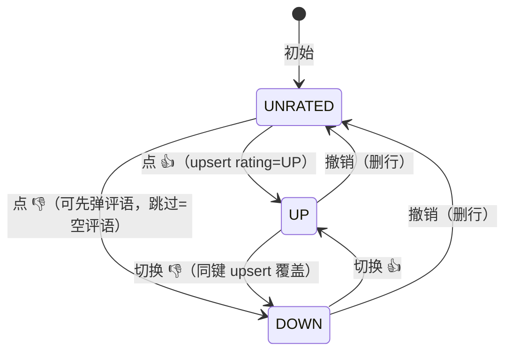

# 消息反馈 + 运行留痕 + 最小看板

| 元信息项   | 内容 |
| ---------- | ---- |
| 文档编号   | OBS-001 |
| 所属迭代   | sprint-obs-1（蓝图 S2 欠账回补） |
| 优先级     | P1 |
| 所属模块   | obs |
| 文档状态   | Implemented（2026-10-22；单测 61 / e2e 13 / jmx 2 计划全绿；走查待人工） |
| 最后更新日期 | 2026-10-21 |
| 上游依赖   | CHAT-001/002（消息镜像与 RunRecord 落库已就绪：conversations events 路由写 message_mirrors / run_records） |
| 下游消费   | OBS-002 用量统计与审计（S5）· STAFF 员工表现视图（远期） |
| 上游依据   | docs/plan/digital-employee-platform-blueprint.md §4 F6（S2 起）/ §6 S2 行 |
| 基线核对   | StaffDeck 消息级反馈语义（§6） |
| 关联架构文档 | api-conventions / rbac-permission-model |
| **高保真确认** | **批量待走查**：用户 2026-10-21 授权按蓝图顺序自动推进（会话指令「按蓝图 sprint 顺序依次完成开发，开发完后自动提交远程代码」）；走查随迭代批量补，打回即回改并重走查 |
| 工作量估算 | 后端 1.5 人日 / 前端 1.5 人日 / 联调 0.5 人日 |

## 1. 概述

### 1.1 功能定位

补齐蓝图 S2 的运营观测闭环：① 对话消息级 👍/👎 反馈（含可选评语）；② RunRecord 留痕列表页（执行可追溯，失败原因透出）；③ 最小看板（调用量/成功率/时长/token）。数据侧零新建表——`message_feedback` 与 `run_records` 均已一次建齐且 chat 链路在写。

### 1.2 范围边界表

| 能力 | 本迭代 | 去向 |
| ---- | ------ | ---- |
| 消息反馈 upsert（👍/👎/撤销 + 评语） | ✅ | — |
| /runs 留痕列表（状态过滤/分页/错误透出） | ✅ | — |
| 最小看板（今日调用/成功率/时长/token） | ✅ | — |
| 反馈看板页（评语聚合/趋势） | ❌ | OBS-002 |
| 按员工/模型维度下钻 | ❌ | OBS-002 |
| 反馈驱动的人设演进提案闭环 | ❌ | 远期（蓝图 F6） |

### 1.3 前置依赖表

| 依赖 | 阻塞原因 |
| ---- | -------- |
| MessageMirror 落库（events 路由，已就绪） | 反馈挂载对象 |
| RunRecord 落库（messages/events 路由，已就绪） | 留痕数据源 |

### 1.4 能力表（rules/testing §1.2 最小覆盖单位）

| 编号 | 能力 | 交互类型 |
| ---- | ---- | -------- |
| OBS-001-C1 | 员工消息 hover 出现 👍/👎；用户消息无操作区 | UI |
| OBS-001-C2 | 点 👍 → 已反馈态常驻；再点撤销；👍/👎 互斥切换 | UI |
| OBS-001-C3 | 👎 可附评语（≤1024，可选提交/跳过） | UI/弹层 |
| OBS-001-C4 | /runs 列表：状态 pill 五态 + 时长/token + 会话链接 | UI |
| OBS-001-C5 | FAILED 行错误原文透出 | UI |
| OBS-001-C6 | 状态过滤 Tab（全部/成功/失败/已中断，含计数） | UI |
| OBS-001-C7 | 页头统计卡四项（count-up，tabular-nums） | UI |
| OBS-001-C8 | 空态（无运行记录 → 引导发起对话） | UI |
| OBS-001-C9 | 未登录 401/跳转；MEMBER 只读可看 /runs（OBS_RUN:READ） | API/UI |

### 1.5 基线核对

StaffDeck：消息级 👍/👎 + 文本评语、反馈进员工表现。本项目同语义；差异：不做即时演进闭环（远期）。

## 2. 业务逻辑

### 2.1 反馈状态机（每条员工消息独立）

规则：`@@unique([messageMirrorId])` 单消息一条反馈；评语仅 DOWN 可填（UP 提交评语忽略）；反馈人=当前会话操作者（不记录第三方身份，单人会话语义）。

### 2.2 看板口径

- 今日调用：`run_records WHERE startedAt >= 今日 00:00（本地时区）` 计数；
- 成功率(7日)：`SUCCEEDED / (总 - 进行中(STARTED/STREAMING))`；
- 平均时长：7 日终态 run 的 `durationMs` 均值（进行中不计）；
- Token(7日)：`tokenIn + tokenOut` 求和。
- 聚合用 Prisma `groupBy`/`aggregate`（禁拼 SQL，rules/database §5.1），列表页统计禁实时扫全表（7 日窗口索引 `@@index([conversationId, status])` 之外新增 `startedAt` 过滤走 count，数据量 S2 期可接受，>万级时登记冗余列——本条为规格登记决策）。

### 2.3 边界与异常

| 场景 | 行为 |
| ---- | ---- |
| 对不存在/非本组织消息反馈 | 404 |
| rating 非法值 / 评语超长 | 422（zod） |
| 未登录 | 401（API）/ 跳登录（页面） |
| 运行进行中 | 留痕行显示 STREAMING 呼吸点，无时长 |

## 3. UI/UX 设计

**原型**：`docs/design/OBS-001-feedback-rundashboard/prototype.html`（A 反馈交互 / B 评语弹层 / C /runs 页 / C2 空态）。

要点：反馈操作条在员工气泡下方 hover 显现（已反馈态常驻）；/runs 页头统计卡 count-up（L3 仅统计卡）；状态 pill 语义色（SUCCEEDED=success 呼吸点关闭、FAILED=danger、INTERRUPTED=muted、STREAMING=success 呼吸点、STARTED=muted）；失败错误原文 mono + danger-subtle 底（§5.7 真实原因透出）；AppShell 新增「运行观测」菜单。

## 4. 技术架构

### 4.1 数据模型

零 DDL（`message_feedback` / `run_records` 已一次建齐；无新增列）。

### 4.2 API 契约（zod 于 packages/shared/obs.ts——新文件）

| 方法·路径 | 说明 |
| --------- | ---- |
| `PUT /api/v1/messages/{mirrorId}/feedback` | body `{ rating: "UP" \| "DOWN" \| null, comment?: string }`；rating=null 删行（撤销）；upsert 语义；权限 `ORG_CHAT:SEND` |
| `GET /api/v1/runs?status=&page=&pageSize=` | 列表信封 `{items, total}`；include conversation(+employee title/name)；权限 `OBS_RUN:READ`（新登记权限点） |
| `GET /api/v1/runs/stats` | `{ todayCount, successRate7d, avgDurationMs7d, tokens7d }`；权限 `OBS_RUN:READ` |

zod：`feedbackInput`（rating 枚举含 null、comment ≤1024）、`runListQuery`（status 白名单枚举）、`runStatsDto`、`runDto`（含 employeeName/conversationTitle 冗余展示字段）。

### 4.3 权限点

`packages/shared/permissions.ts` 登记 `OBS_RUN:READ`（MEMBER 只读天然放行——`endsWith(":READ")`）。反馈写走既有 `ORG_CHAT:SEND`。

### 4.4 前端组件

- `components/ChatBubble.tsx`：assistant 分支加反馈操作条（loading/已反馈态；👎 弹 Modal 评语）；
- `app/runs/page.tsx`（新）：页头统计卡（count-up）+ 过滤 Tab + Table + 空态 + 失败行展开（Table expandable）；
- `AppShell.tsx`：菜单加「运行观测」（`/runs`，AreaChartOutlined）。
- api-client：`obsApi.feedback/runs/runStats`。

## 5. 测试用例

### 5.1 功能用例表

| 编号 | 前置 | 步骤 | 预期 |
| ---- | ---- | ---- | ---- |
| OBS-001-01 | mock 对话一轮完成 | 员工消息点 👍 | 已反馈·有帮助常驻；DB 一行 rating=UP |
| OBS-001-02 | 已 👍 | 再点 👎 附评语 | 切换 DOWN + 评语落库（同键覆盖） |
| OBS-001-03 | 已反馈 | 点撤销 | 回到未反馈态；行删除 |
| OBS-001-04 | 造 FAILED run（interrupt 或上游错） | 打开 /runs | FAILED 行 + 错误原文可见 |
| OBS-001-05 | 无数据账号 | 打开 /runs | 空态引导 |
| OBS-001-06 | 未登录 | GET /runs | 401 信封；页面跳登录 |
| OBS-001-07 | 任一数据态 | 看统计卡 | 四卡数字与库内聚合一致 |

### 5.2 JMeter（tests/api/OBS-001-feedback-rundashboard.jmx）

正常（PUT 反馈 200+code0+rating 回显 / GET runs 信封 / GET stats 四字段非空）/ 401 未认证 / 403（豁免同 TEAM-001：无 MEMBER 账号）/ 422（rating 非法、评语超长、mirrorId 不存在→404）。自建数据自清理。

### 5.3 Playwright（tests/e2e/OBS-001-feedback-rundashboard.spec.ts）

每条含 UI + Console + 接口三类断言：从首页导航→chat 发起对话（mock 流式完成）→反馈交互（expectApi PUT 钉方法）→/runs 看板与列表。

### 5.4 二态覆盖

未反馈/已反馈（C1/C2）· 👍/👎 · 空态/有数据（C8/C4）· 成功/失败运行（C4/C5）· 未登录/已登录（C9）。

### 5.5 性能与安全注意

stats 聚合 ≤ 500ms（7 日窗口）；评语文本入参数化（Prisma 天然）；反馈内容按普通用户输入校验长度（不做富文本）。

## 6. 基线深度对标

| 维度 | StaffDeck | 本项目 |
| ---- | --------- | ------ |
| 反馈粒度 | 消息级 👍/👎 + 评语 | 同 |
| 反馈用途 | 员工表现/演进 | 进看板聚合；演进闭环远期 |
| 留痕 | run 记录页 | 同 + 失败原文透出 + 状态过滤 |

## 7. 里程碑与验收

**交付清单**：shared obs zod + 权限点 → API（feedback/runs/stats + jmx）→ ChatBubble 反馈 UI + /runs 页 + 菜单（e2e）→ 文档流转。

**DoD**：单测/jmx/e2e 绿 → 远端 CI 绿 → push（用户已授权自动提交）。

**二态豁免登记**：e2e 确定性覆盖 SUCCEEDED/INTERRUPTED 两态（mock 无法确定性产出 FAILED run）；FAILED 行错误透出（C5）由 jmx 404 信封 + 人工走查覆盖，mock 故障注入（FAIL: 前缀）随 TEAM-002 深编排评估补齐。

**演示脚本**：对话一轮 → 👍 → 切 👎 附评语 → 撤销 → /runs 看板 + 失败行错误。

**回归范围**：chat 流式链路（ChatBubble 改动）· staffs stats 页（共用 run_records）。
