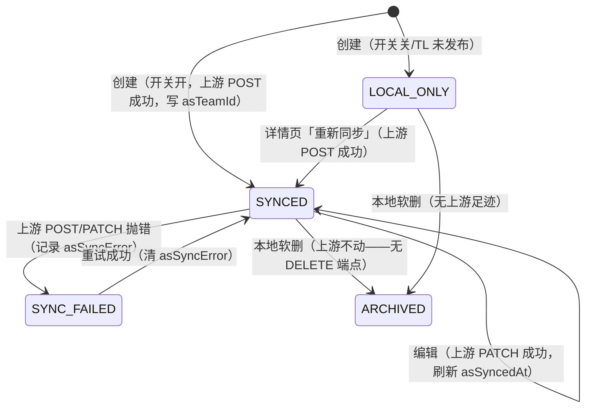

# 团队协作复用 AgentScope teams（浅映射）

| 元信息项   | 内容 |
| ---------- | ---- |
| 文档编号   | TEAM-001 |
| 所属迭代   | sprint-team-1 |
| 优先级     | P1 |
| 所属模块   | team |
| 文档状态   | Prototyped |
| 最后更新日期 | 2026-10-21 |
| 上游依赖   | SYS（认证/权限）· STAFF（员工发布写 asAgentId）· AgentScope 实例（teams/agent-tasks 端点） |
| 下游消费   | TEAM-002（任务分派/竞标，深编排）· CHAT（团队会话，远期） |
| 上游依据   | docs/plan/digital-employee-platform-blueprint.md F7 / M5 / R6（浅映射口径，原排期 S9+ 经产品决策提前） |
| 基线核对   | AgentScope agent-center 控制台 teams 页（§6） |
| 关联架构文档 | api-conventions / rbac-permission-model / dependency-graph |
| **高保真确认** | **已确认**：xuqianrong / 2026-10-21 / `docs/design/TEAM-001-agentscope-team-sync/` |
| 工作量估算 | 后端 2 人日 / 前端 2 人日 / 联调 1 人日 |

## 1. 概述

### 1.1 功能定位

teams 模块当前是纯本地组织管理层（无规格先行产物：列表/详情/成员管理已上线）。本功能为其接入 AgentScope 运行面（`AGENTSCOPE_BASE_URL` 实例）的 **teams 浅映射**（蓝图 R6 口径）：本地团队 CRUD 与上游团队建立双向关联（建/改同步、删留档），团队详情页新增任务只读视图（agent-tasks）。**不含**任务创建/分派/竞标（TEAM-002+）与成员级运行时参与（上游 team 仅 leaderAgentId 单 leader 模型）。

### 1.2 范围边界表

| 能力 | 本迭代 | 去向 |
| ---- | ------ | ---- |
| 团队创建/编辑同步上游（asTeamId 关联） | ✅ | — |
| 团队删除上游留档（实测无 DELETE 端点） | ✅ | 上游支持删除后再评估 |
| 任务 Tab 只读列表（agent-tasks） | ✅ | — |
| 任务创建/分派/竞标/黑板 | ❌ | TEAM-002（蓝图 R6 深编排） |
| 成员级运行时参与（上游无成员概念） | ❌ | 待上游模型演进 |
| 同步失败自动重试队列 | ❌ | 手动重试即可（浅映射）；自动化随 BullMQ 任务体系 |

### 1.3 前置依赖表

| 依赖 | 阻塞原因 |
| ---- | -------- |
| STAFF 发布链路写 asAgentId（已上线） | leaderAgentId 映射来源 |
| AgentScope 实例 teams/agent-tasks 端点（2026-10-21 实测冻结，§4.1） | 全部同步能力 |
| `Team.asTeamId` 列（schema.prisma:493 已预留） | 关联存储 |

### 1.4 能力表（测试最小覆盖单位，rules/testing §1.2）

| 编号 | 能力 | 交互类型 |
| ---- | ---- | -------- |
| TEAM-001-C1 | 创建团队（同步开关开 + TL 已发布）→ 本地建队 + 上游建 team + asTeamId 写入 | API/表单 |
| TEAM-001-C2 | 创建团队（开关关或 TL 未发布）→ 仅本地建队，徽标「未同步」 | API/表单 |
| TEAM-001-C3 | 编辑团队（改名/换 TL）→ 上游 PATCH（name+leaderAgentId 必填） | API/表单 |
| TEAM-001-C4 | 删除团队 → 本地软删 + 确认文案明示上游留档 | API/弹窗 |
| TEAM-001-C5 | 详情页运行面状态行：asTeamId（mono）+ 最近同步时间 + 重新同步按钮 | UI |
| TEAM-001-C6 | 任务 Tab：agent-tasks 只读表格（任务/状态 pill/分派对象/更新时间） | UI |
| TEAM-001-C7 | 任务 Tab 空态：引导文案 + 刷新出口 | UI |
| TEAM-001-C8 | 同步失败：横幅透出真实错误 + 重试成功后消失 | UI |
| TEAM-001-C9 | 列表卡片同步徽标三态（已同步/同步失败/未同步） | UI |
| TEAM-001-C10 | 权限视角：普通成员 ORG_TEAM:UPDATE 无权 → 403/禁用；未登录跳转 | API/UI |

### 1.5 基线核对

AgentScope agent-center 控制台（`/agent-center/teams`）：团队列表 + 任务列表 + policy 配置。本项目**不复制其管理界面**，只做平台侧只读投影 + 组织管理联动（差异见 §6）。

## 2. 业务逻辑

### 2.1 同步状态机（本地 Team 视角）



### 2.2 规则明细

1. **创建**：请求体新增 `syncToRuntime`（默认 true）。true 且 TL 的 `asAgentId` 非空 → 上游 `POST /api/v1/teams`（name、leaderAgentId=TL.asAgentId）；成功写 `asTeamId/asSyncedAt`，失败记 `asSyncError` **但本地创建照常成功**（201）。false 或 TL 未发布 → 仅本地。
2. **编辑**：`asTeamId` 非空时，改名或换 TL → 上游 `PATCH`（name+leaderAgentId **两者必填**，2026-10-21 实测）；上游失败 → 本地成功 + `asSyncError`。仅改 description/goal 不触发上游。
3. **删除**：本地软删（现状不变）；`asTeamId` 非空时确认文案明示「运行面保留存档」。
4. **手动同步/重试**：`asTeamId` 空 → 上游 POST（幂等风险：同名已存在时上游 4xx → 转为列表匹配既有 team 回写 asTeamId）；非空 → PATCH。
5. **任务视图**：`GET /api/v1/teams/{id}/tasks` 代理上游 agent-tasks；上游失败返回 200 + 空列表 + `degraded: true`（视图降级不阻塞页面，横幅提示）。

### 2.3 边界与异常

| 场景 | 行为 |
| ---- | ---- |
| TL 未发布（asAgentId 空） | 同步开关禁用 + 提示；创建/换 TL 不触发上游 |
| 上游 401/超时（AGENTSCOPE_TIMEOUT_MS=30s） | 同步失败横幅 + 可重试；**不阻塞本地 CRUD** |
| 上游 team 名冲突（同 namespace 重名） | 手动同步时列表匹配回写，不重复建 |
| agent-tasks 响应形状未冻结（实例无数据） | zod 防御式解析（字段可选），解析失败按空列表降级 |
| 未登录 / 无权限 | middleware 401 跳转 / requirePermission 403（现状） |

## 3. UI/UX 设计

**高保真原型**：`docs/design/TEAM-001-agentscope-team-sync/prototype.html`（A 列表徽标三态 / B 详情页+任务 Tab / B2 空态 / B3 失败横幅 / C 新建弹窗开关 / D 删除留档确认）。

要点：详情页 Tab 化（成员管理｜任务，MASTER §5.3）；运行面状态行展示 asTeamId（mono）+ 最近同步 + 重新同步；任务表格状态 pill 映射上游原值（active=success 呼吸点 / pending=muted / completed=success 静止 / failed=danger）；同步徽标三态色（success/warning/muted）；所有错误透出真实原因（rules/react-nextjs §5.7）。

## 4. 技术架构

### 4.1 AgentScope 契约（2026-10-21 实测冻结，实例 106.52.237.179:10946）

| 端点 | 形态 |
| ---- | ---- |
| `GET /api/v1/teams?tenant&namespace` | `{items: AsTeam[]}` |
| `POST /api/v1/teams` | `{tenant,namespace,name,leaderAgentId}` → `{team}`（policy 可选默认 {}） |
| `GET /api/v1/teams/{id}` | `{team}` |
| `PATCH /api/v1/teams/{id}` | `{name, leaderAgentId}` 两者必填 → `{team}`，version 自增 |
| `DELETE /api/v1/teams/{id}` | **404 无此端点**（删除留档依据） |
| `GET /api/v1/agent-tasks?tenant&namespace` | `{items: []}`（形状待实例有数据后复核，R-TASK-SHAPE） |

`AsTeam = { id, tenant, namespace, name, status, leaderAgentId, policy: {maxActiveTasks?, maxHops?, maxChildDepth?, maxChildIssues?, maxFanout?}, version, createdAt, updatedAt }`。

### 4.2 数据模型（Prisma，migration `TEAM-001-add-team-sync-cols`）

```prisma
model Team {
  // 既有：asTeamId（已预留）
  asSyncedAt   DateTime? @map("as_synced_at")   // 最近一次上游同步成功时间
  asSyncError  String?   @map("as_sync_error") @db.VarChar(512) // 最近失败原因（透出给前端）
}
```

> 一次建齐说明：Team 表系规格外先行产物，本规格为 team 域首份规格，本 migration 视同「域首份一次建齐」补列；此后 team 域列变更需过架构评审。

### 4.3 packages/agentscope 扩展（适配层唯一出口，蓝图 §5.1）

- `types.ts`：`AsTeam`、`AsAgentTask`（防御式可选字段）
- `client.ts`：`listTeams / createTeam / updateTeam / listAgentTasks`
- `AgentScopeProvider` 接口新增：`ensureTeam({name, leaderAgentId, asTeamId?})`（建/改归一 + 名称冲突回写）、`listAgentTasks()`
- `mock.ts`：确定性 teams/tasks 数据（含故障注入 scenario，供 e2e 失败态用例）

### 4.4 API 契约（zod 定义于 packages/shared/team.ts）

| 方法·路径 | 变更 |
| --------- | ---- |
| `POST /api/v1/teams` | 入参 +`syncToRuntime?: boolean`；响应 DTO +`syncState: "SYNCED" \| "LOCAL_ONLY" \| "SYNC_FAILED"`、`asTeamId?`、`asSyncError?` |
| `PATCH /api/v1/teams/{id}` | 同上（响应扩展） |
| `GET /api/v1/teams` / `GET /api/v1/teams/{id}` | DTO +`syncState/asTeamId/asSyncedAt/asSyncError` |
| `POST /api/v1/teams/{id}/sync` | 手动同步/重试（asTeamId 空→建，非空→改）；权限 `ORG_TEAM:UPDATE` |
| `GET /api/v1/teams/{id}/tasks` | 代理 agent-tasks，`{items: TaskDto[], degraded: boolean}`；权限 `ORG_TEAM:READ` |

前端仅经 `packages/api-client`（teamApi.create/update/detail/list/sync/tasks）。

### 4.5 前端组件

- `teams/page.tsx`：卡片 +`syncState` 徽标（StatusPill 语义色）
- `teams/[id]/page.tsx`：Tab 化（成员管理｜任务）；运行面状态行；失败横幅 + 重试；任务表格/空态
- 新建/编辑弹窗：`syncToRuntime` 开关（TL 未发布时禁用 + 提示）；删除确认文案更新

### 4.6 权限点

复用既有 `ORG_TEAM:READ / CREATE / UPDATE / DELETE`（无新增权限点）；`/sync` 归 `ORG_TEAM:UPDATE`，`/tasks` 归 `ORG_TEAM:READ`。

## 5. 测试用例

### 5.1 功能用例表（编号 ↔ 测试文件一致）

| 编号 | 前置 | 步骤 | 预期 |
| ---- | ---- | ---- | ---- |
| TEAM-001-01 | mock 上游正常、TL 已发布 | 创建团队（syncToRuntime=true） | 201；asTeamId 非空；syncState=SYNCED |
| TEAM-001-02 | TL 未发布 | 创建团队 | 201；LOCAL_ONLY；徽标「未同步」 |
| TEAM-001-03 | 已同步团队 | 改名 | 200；上游收到 PATCH（name+leaderAgentId）；asSyncedAt 刷新 |
| TEAM-001-04 | 已同步团队 | 删除 | 软删；上游 team 仍存在 |
| TEAM-001-05 | 上游故障注入 | 创建 + 编辑 | 本地成功；SYNC_FAILED；asSyncError 含 HTTP 状态 |
| TEAM-001-06 | 上游故障后恢复 | 详情页点「重试同步」 | SYNCED；横幅消失 |
| TEAM-001-07 | mock 上游有任务 | 打开任务 Tab | 表格渲染；状态 pill 正确 |
| TEAM-001-08 | 上游无任务 | 打开任务 Tab | 空态 + 刷新出口 |
| TEAM-001-09 | 上游故障 | 打开任务 Tab | degraded=true + 提示，不白屏 |
| TEAM-001-10 | 普通成员账号 | 创建/编辑/删除/同步 | 403（接口断言）+ 按钮禁用（UI 断言） |

### 5.2 JMeter（tests/api/TEAM-001-agentscope-team-sync.jmx，四类×四项断言）

正常路径（POST/PATCH/sync/tasks 200+code0+关键字段）/ 401 未认证 / 422（名称超长、syncToRuntime 非布尔）/ tasks 分页信封。自建数据自清理（本地软删 + mock 上游无状态）。
**403 显式豁免**：当前无 MEMBER 种子账号与用户管理 API（rbac §4 最小实现），TEAM-001 未新增权限点（复用 ORG_TEAM:*），权限拒绝路径由 `requirePermission` 代码 + e2e 未登录守卫（TEAM-001-05）覆盖；用户管理域落地后补 MEMBER 视角用例。

### 5.3 Playwright（tests/e2e/TEAM-001-agentscope-team-sync.spec.ts，三类断言）

每条含 UI 断言（徽标/Tab/表格/横幅）+ Console 断言（fixtures expectNoConsoleErrors）+ 接口断言（expectApi 钉方法：`POST /api/v1/teams`、`GET /api/v1/teams/*/tasks`）；从首页真实导航进入（§3.2.2）；AGENTSCOPE_MODE=mock 确定性运行。

### 5.4 关键状态二态覆盖

同步开/关（C1/C2）· 上游成功/失败（C1/C8）· 任务空/有（C7/C6）· 有权/无权（C10）· 未登录/已登录（既有 middleware 断言回归）。

### 5.5 性能与安全注意

tasks 代理透传上游时延（30s 超时须页面降级提示，不挂整页）；同步失败信息不得含上游凭据（复用 AgentScopeError 截断 300 字符）；audit 记录团队同步重试操作。

## 6. 基线深度对标

| 维度 | AgentScope 控制台 | 本项目 |
| ---- | ----------------- | ------ |
| 定位 | 运行面管理（policy/任务全量操作） | 组织管理层 + 只读任务投影 |
| 团队模型 | leader 单 agent + policy | TL + 多成员（组织视角）；运行面仅映射 leader |
| 任务操作 | 全量 CRUD/分派 | 只读列表（R6 浅映射），创建跳控制台 |
| 删除 | 无删除端点（实测） | 本地软删 + 留档明示 |

## 7. 里程碑与验收

**交付清单**：packages/agentscope 扩展（client/types/mock + 单测）→ migration TEAM-001 → shared zod/DTO → API（teams CRUD 扩展 + sync + tasks + jmx）→ 前端（列表徽标/详情 Tab/弹窗开关/删除文案 + e2e）→ 文档状态流转。

**DoD**：高保真人工确认（前置）→ 单测/jmx/e2e 全绿 → 远端 CI 全绿 → 原型逐项走查登记。

**演示脚本**：新建团队（同步开）→ 列表徽标已同步 → 详情页看运行面状态行 + 任务 Tab → 注入故障编辑 → 失败横幅 → 重试恢复 → 删除（留档文案）。

**回归范围**：teams 既有 CRUD（TEAM-001 前）· STAFF 发布链路 · CHAT（agentscope 包共用）。
